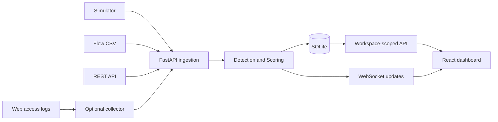

<div align="center">

# NetSentinel

**Explainable threat detection and live monitoring for network and web events.**

An open-source research platform with a real-time dashboard, hybrid detection pipeline, and an optional web access-log collector.

[](https://www.python.org/)
[](https://react.dev/)
[](https://fastapi.tiangolo.com/)
[](https://vitejs.dev/)
[](https://www.sqlite.org/)
[](https://www.docker.com/)

[Features](#what-it-does) | [Architecture](#how-it-works) | [Docker Lab](#run-the-local-docker-lab) | [Data & Workspaces](#data-and-workspaces) | [Documentation](#documentation)

</div>

> [!IMPORTANT]
> **NetSentinel is research and educational software, not a production security control.** Shipped models were trained on simulated data, so their metrics do not establish real-world performance. Mitigations are currently simulated and do not change a firewall, web application firewall, or other system. Use the vulnerable target only in the local lab, and test only systems you own or are authorised to assess.

## What it does

- Ingests events from a traffic simulator, network-flow CSV uploads, the REST API, and an optional web access-log collector.
- Scores events using signature and behaviour rules, a text classifier for web requests, and a supervised model ensemble with anomaly detection for flow data.
- Presents alerts with detector evidence, risk scores, trends, coverage information, and suggested response steps.
- Streams dashboard updates over WebSockets and scopes users, sources, events, alerts, and settings to workspaces.
- Supports workspace owners, admins, analysts, and viewers, with Google sign-in for workspace owners and username/password accounts for invited members.
- Provides CSV analysis, PDF/CSV reports, audit history, and a rule-based assistant that uses application data without calling an external AI service.

The live collector currently processes web-server access logs. It is not a packet sensor or endpoint monitor. Standard access logs do not contain request bodies, so attacks recorded only in a POST body are outside its visibility.

## How it works



The backend is Python and FastAPI. The frontend is React with Vite, served by Nginx in Docker. In the default deployment, SQLite stores the application database; the Docker Compose files mount it in a named volume so data survives container replacement. The lab also has separate persistent volumes for DVWA's MariaDB data, proxy logs, and collector state.

## Run the local Docker lab

The lab starts the dashboard, backend, access-log collector, and a deliberately vulnerable DVWA target. It binds the dashboard to `localhost:8080` and the target to `localhost:8081`.

Requirements: Docker with the Compose plugin and approximately 4 GB of available memory.

From the repository root:

```bash
docker compose --env-file .env -f lab/docker-compose.lab.yml up --build -d
```

Create `.env` from `.env.example` before starting if it does not exist. Keep `.env` private and never commit it. Open the dashboard at <http://localhost:8080>. To initialise DVWA, open <http://localhost:8081/setup.php> and create its database. The lab's test credentials and setup details are documented in [the lab guide](lab/README.md); they are for this isolated lab only and must not be reused elsewhere.

Stop the lab and retain its data:

```bash
docker compose --env-file .env -f lab/docker-compose.lab.yml down
```

To rebuild only the dashboard after frontend changes:

```bash
docker compose --env-file .env -f lab/docker-compose.lab.yml up --build -d --no-deps frontend
```

This recreates the frontend service while retaining the Compose project and its data volumes. The root `docker-compose.yml` also publishes port 8080; run only one Compose project at a time.

## Data and workspaces

In the supplied Docker setup, workspace records, users, events, alerts, sources, and audit records are stored in the backend's SQLite database under `/app/data`, backed by a named Docker volume. A new Google sign-in can create a private workspace; the registering account owns it. Workspace members are created by that workspace's administrators and access only their workspace through the application. The local development database is configured by `DB_PATH` (default: `./data/cyberwatch.db`).

The named volume is persistent on the Docker host, but it is not a managed cloud database or a backup strategy. Anyone deploying for real users must arrange encrypted backups and recovery tests and should plan a move to managed PostgreSQL and object storage before scaling beyond a small, single-host pilot. The application currently uses SQLite; a PostgreSQL deployment requires an application/database migration and verification rather than just changing a hosting setting.

## Technology

- **Frontend:** React, Vite, Recharts
- **Backend:** Python, FastAPI, Pydantic, Uvicorn
- **Detection:** scikit-learn, NumPy, pandas; optional XGBoost and LightGBM
- **Storage:** SQLite in the default deployment
- **Packaging and serving:** Docker Compose, Nginx

## Configuration and development

Copy `.env.example` to `.env` and review the settings for your environment. The first-run administrator username and password, signing secret, Google client ID, database path, model locations, and upload limits are configured through environment variables. Production mode requires explicit security settings. Never commit `.env`, credentials, real user data, or production database files.

For local development, install the dependencies in `backend/requirements.txt` and `frontend/`, then run FastAPI from `backend/` and Vite from `frontend/`. The Vite development server proxies API and WebSocket requests to the backend. See [the environment template](.env.example) and [architecture documentation](docs/ARCHITECTURE.md) for configuration and implementation detail.

## Project layout

```text
backend/       FastAPI application, APIs, detection pipelines, and tests
frontend/      React dashboard and Vite configuration
collector/     Optional web access-log collector
docker/        Dockerfiles and Nginx configuration
lab/           Local Compose lab, target proxy, and walkthrough
models/        Shipped model artifacts
data/          Schemas and local runtime data
scripts/       Training, sample data, and verification utilities
docs/          Architecture, API, security, detector, and evaluation docs
```

## Documentation

- [Architecture](docs/ARCHITECTURE.md)
- [API design](docs/API_DESIGN.md)
- [Data model](docs/DATA_MODEL.md)
- [Connector setup](docs/CONNECTORS.md)
- [Web detector](docs/WEB_DETECTOR.md)
- [ML pipeline](docs/ML_PIPELINE.md)
- [Research evaluation and limitations](docs/RESEARCH_EVALUATION.md)
- [Security design](docs/SECURITY_DESIGN.md)
- [Docker lab walkthrough](lab/README.md)
- [Project roadmap](docs/PROJECT_ROADMAP.md)

## Current limitations

- Model evaluation on simulated data does not establish production detection quality.
- Live ingestion is limited to web access logs; it does not collect packets, endpoint telemetry, or request bodies that are absent from logs.
- Mitigations are simulated and do not enforce network or host controls.
- SQLite and in-memory behaviour tracking are intended for local and small single-instance use, not a horizontally scaled service.
