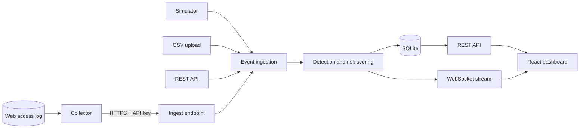

<div align="center">

# Argus

**Explainable threat detection and live monitoring, runnable on your own machine.**

A hybrid detection pipeline, a real-time dashboard, and a log collector that connects a real web server in minutes.

[](https://www.python.org/)
[](https://fastapi.tiangolo.com/)
[](https://react.dev/)
[](https://vitejs.dev/)
[](https://scikit-learn.org/)
[](https://www.sqlite.org/)
[](https://www.docker.com/)


[Quick start](#quick-start) · [Features](#features) · [How it works](#how-it-works) · [Connect a web server](#connect-your-own-web-server) · [Configuration](#configuration) · [Documentation](#documentation)

</div>

> [!IMPORTANT]
> **Argus is research and educational software.** The shipped detection models are trained on simulated data, so their metrics do not establish real-world detection performance. Mitigations produce *simulated* rules and are never applied to a firewall or production system. Do not use Argus as your only security control.

---

## Overview

Argus watches a stream of security events, decides which ones are threats, and explains why. It accepts events from four places: a built-in simulator, CSV uploads, a REST API, and an optional **collector** that streams a real web server's access log to the dashboard in real time.

Every alert comes with the evidence behind it, a risk score, and attack-specific mitigation guidance. The whole system runs locally, either with a single Docker command or as a normal Python and Node.js development setup.

## Features

| Capability | What you get |
| --- | --- |
| **Hybrid detection** | Signature rules, behaviour tracking, a text model for web requests, and a supervised model ensemble with an autoencoder for network flows. |
| **15 attack types** | SQL injection, XSS, brute force, DDoS, path traversal, command injection, web reconnaissance, phishing, malware, ransomware, botnet, port scanning, insider threat, MITM, and zero-day anomalies. |
| **Explainable alerts** | Each finding lists the detectors that fired, the evidence, a risk score, and mitigation options. |
| **Real-time dashboard** | Live event feed, KPIs, charts, an attack heatmap by hour, and a short-term forecast, streamed over WebSockets. |
| **Live log connector** | A dependency-free collector ships web access logs to Argus with a revocable API key, client-side privacy filters, and no lost or duplicated events. |
| **Honest coverage panel** | Shows which attack types your connected sources can see, which they cannot, and what extra source would cover them. |
| **Demo and Live modes** | Simulated traffic switches off automatically when a real source connects, so real and simulated data never mix. |
| **Role-based access** | Viewer, Analyst, and Admin roles, an audit log, and login rate limiting. |
| **Reports and uploads** | Analyse network-flow CSV files, and export PDF or CSV reports. |
| **Assistant** | A rule-based chatbot that answers questions from your own data. It calls no external service and needs no API key. |
| **Docker lab** | A contained, deliberately vulnerable target website, the collector, and Argus, started with one command. |

---

## Quick start

Pick one path. **Option A** is the fastest way to see Argus detect real attacks.

| | Best for | Needs |
| --- | --- | --- |
| [**A. Docker lab**](#option-a-docker-lab-recommended) | Seeing live detection end to end | Docker |
| [**B. Local development**](#option-b-run-locally-for-development) | Reading, editing, and debugging the code | Python 3.11+, Node.js 18+ |
| [**C. Docker Compose**](#option-c-docker-compose-production-style) | Running the dashboard in containers | Docker |

### Option A: Docker lab (recommended)

The lab runs entirely on your computer and binds to `localhost`. It starts Argus, a deliberately vulnerable website ([DVWA](https://github.com/digininja/DVWA)), a logging proxy in front of it, and the collector that connects them.

> [!WARNING]
> Only send test traffic to the lab target that **you** started. It is intentionally vulnerable. The lab's credentials and API key are public, so never reuse them anywhere else.

**Requirements:** Docker Desktop (or Docker Engine with Compose) and about 4 GB of free memory.

**1. Start the lab** from the repository root. The first run downloads and builds images, which takes several minutes.

```bash
docker compose -f lab/docker-compose.lab.yml up --build -d
```

**2. Open the services.**

| Service | URL | Credentials |
| --- | --- | --- |
| Argus dashboard | <http://localhost:8080> | `admin` / `Lab-Admin-Passw0rd!` |
| DVWA target site | <http://localhost:8081> | `admin` / `password` (after step 3) |

**3. Prepare the target once.** Open <http://localhost:8081/setup.php>, click **Create / Reset Database**, sign in, then set **DVWA Security** to **Low**.

**4. Confirm the connection.** In Argus, open **Sources**. *Lab web server (DVWA)* should show **Connected**, and the Overview switches to **Live mode**. If it stays on *Waiting*, check the collector:

```bash
docker compose -f lab/docker-compose.lab.yml logs collector
```

**5. Attack your own lab.** In DVWA, try one of these, then watch **Alerts** update within seconds:

| DVWA page | What to enter |
| --- | --- |
| SQL Injection | `1' OR '1'='1` in *User ID*, then Submit |
| XSS (Reflected) | `<script>alert(1)</script>` in the name box |
| Brute Force | Submit the login form 10 or more times with different passwords |
| File Inclusion | Change the URL to `?page=../../../../etc/passwd` |

Prefer automation? Run `python lab/attack_demo.py` from the repository root. It sends SQL injection, XSS, path traversal, command injection, brute force, a directory scan, and an HTTP flood, and it refuses any target that is not `localhost`. The [lab walkthrough](lab/README.md) also covers real tools such as `sqlmap` and `nikto` in a throwaway container.

**Stop the lab:**

```bash
docker compose -f lab/docker-compose.lab.yml down        # keeps lab data
docker compose -f lab/docker-compose.lab.yml down -v     # also deletes lab data
```

<details>
<summary><b>Rebuild the lab dashboard after changing frontend code</b></summary>

<br>

```bash
docker compose -f lab/docker-compose.lab.yml up --build -d --no-deps frontend
```

This rebuilds and recreates only the frontend container and keeps the backend and its data volumes.

</details>

### Option B: Run locally for development

**Requirements:** Python 3.11 or newer, Node.js 18 or newer, and npm.

**Shortcut.** The launcher copies `.env`, creates a virtual environment, installs dependencies, and starts both servers.

```bash
run_platform.bat          # Windows
bash run_platform.sh      # macOS / Linux
```

**Manual setup.** Use this if you want to see each step.

**1. Create your environment file.** From the repository root:

```bash
cp .env.example .env      # Windows PowerShell: Copy-Item .env.example .env
```

The defaults work for local development. Optionally set `ADMIN_PASSWORD` to choose your own first-run password.

**2. Install the backend.**

```bash
python -m venv .venv                      # use python3 on macOS / Linux
.venv\Scripts\Activate.ps1                # Windows PowerShell
# source .venv/bin/activate               # macOS / Linux
pip install -r backend/requirements.txt
```

**3. Start the backend** (port 8000).

```bash
cd backend
python -m uvicorn app.main:app --reload
```

**4. Start the frontend** in a second terminal (port 5173).

```bash
cd frontend
npm install
npm run dev
```

**5. Open <http://localhost:5173>** and sign in as `admin`. The password is `ADMIN_PASSWORD` from `.env`. If you left it empty, Argus generates one and prints it **once** in the backend terminal. Interactive API docs are at <http://localhost:8000/docs> (development only).

On a fresh install Argus starts in **Demo mode** with simulated traffic. To fill the charts with a day of simulated history, run `python scripts/seed_demo.py` from the repository root.

### Option C: Docker Compose (production-style)

This builds the backend and a Nginx-served frontend. The backend image runs with `APP_ENV=production`, which **refuses to start** with weak defaults.

**1.** Copy `.env.example` to `.env` and set these three values:

```ini
JWT_SECRET=<a long random value>
ADMIN_PASSWORD=<a strong password>
CORS_ORIGINS=http://localhost:8080
```

Generate a secret with `python -c "import secrets; print(secrets.token_urlsafe(48))"`.

**2.** Start it and open <http://localhost:8080>:

```bash
docker compose up --build
```

> [!NOTE]
> This Compose file and the lab both publish port **8080**. Run only one of them at a time.

---

## How it works



The backend is a FastAPI application. Each event runs through the matching detection pipeline, is scored, stored in SQLite, and published to connected dashboards. The React frontend is built with Vite; in Docker it is served by Nginx, which also proxies API and WebSocket traffic to the backend.

**Two detection pipelines**

| Pipeline | Input | Method |
| --- | --- | --- |
| **Network flow** | Simulator, uploads, API | Signature rules, a Random Forest, Gradient Boosting and neural-network ensemble, plus an autoencoder for zero-day anomalies. XGBoost and LightGBM are used automatically when you retrain, if they are installed. |
| **Web request** | Collector (access logs) | Signature rules, a sliding-window behaviour tracker, and a character n-gram text model, fused into one verdict. |

**Data scopes.** Every event is tagged as *live* (from a real connector), *demo* (simulated), or *upload*. The dashboard can show each scope separately, and in **Auto** mode it shows live data whenever a real source is connected.

---

## Connect your own web server

Argus never reaches into your systems. Instead, a small collector next to your web server reads its access log and sends events to Argus.

1. In Argus, open **Sources → Connect a source** (Admin role).
2. Choose a name, what to hide (excluded paths, redacted parameters, optional IP pseudonyms), then copy the API key. **It is shown only once.**
3. Run the collector next to your web server. It needs Python 3.8+ and no other packages:

```bash
export ARGUS_KEY='agk_...'          # PowerShell: $env:ARGUS_KEY = 'agk_...'
python argus_collector.py --url https://your-argus-host --file /var/log/nginx/access.log
```

The wizard shows a live "Waiting… Connected!" indicator and generates the exact command for Linux, macOS, Windows, and Docker. It reads Nginx and Apache *combined* logs and JSON logs. Secrets are redacted and excluded paths are dropped **on your machine, before anything is sent**. You can revoke a source's key at any time.

Full options, service setup, and troubleshooting are in the [collector README](collector/README.md) and [connector docs](docs/CONNECTORS.md).

### What log-based monitoring can detect

The web-log connector covers **SQL injection, XSS, brute force (web logins), path traversal, command injection, web reconnaissance, and DDoS (HTTP floods)**. It cannot see ransomware, malware, or lateral movement, and standard access logs do not record request bodies, so attacks inside POST bodies are invisible. The **Coverage** tab shows this for your exact setup.

---

## Using the dashboard

| Page | Purpose |
| --- | --- |
| **Overview** | Live KPIs, traffic and threat charts, attack heatmap, forecast, top attackers, and the live event feed. |
| **Alerts** | Filter and search alerts, open one to see why it was flagged, and triage or mitigate it. |
| **Sources** | Connect and manage sources, rotate or revoke keys, and review attack coverage. |
| **Models** | Review model metrics and per-attack performance. Admins can retrain. |
| **Upload & Analyse** | Analyse a flow CSV (a sample is provided) and keep a private upload history. |
| **Admin** | Manage users, settings, the simulator mode, mitigations, and the audit log. |
| **Account** | Profile, light or dark theme, and password change. |

**Roles**

| Role | Can do |
| --- | --- |
| **Viewer** | Read dashboards, alerts, models, and the PDF summary; use the assistant. Self-registered accounts are always Viewers. |
| **Analyst** | Everything a Viewer can, plus change alert status, apply simulated mitigations, upload and analyse files, and export CSV. |
| **Admin** | Everything an Analyst can, plus manage users, sources, settings, simulator mode, model retraining, and view the audit log. |

---

## Configuration

Settings come from environment variables or a `.env` file in the repository root; real environment variables take priority. [`.env.example`](.env.example) lists every option with comments. The most important ones:

| Variable | Purpose |
| --- | --- |
| `APP_ENV` | `development` (default) or `production`, which enforces the security checks below. |
| `JWT_SECRET` | Token signing key. Required in production. If empty in development, a temporary key is used and sessions reset on restart. |
| `ADMIN_USERNAME` / `ADMIN_PASSWORD` | First administrator. In development an empty password is generated and printed once. |
| `ALLOW_SELF_REGISTRATION` | Lets visitors create Viewer accounts. Admins can also toggle this in the UI. |
| `CORS_ORIGINS` | Browser origins allowed to call the API. No wildcard in production. |
| `SIMULATION_ENABLED` | Starts the simulator on a fresh install. In Auto mode it pauses when a real source connects. |
| `DB_PATH`, `MODEL_DIR`, `WEB_MODEL_DIR` | Locations of the SQLite database and model files. |
| `MAX_UPLOAD_MB`, `MAX_UPLOAD_ROWS` | Upload limits. |
| `SMTP_*`, `ALERT_EMAIL_*` | Optional email notifications for new alerts. |
| `INGEST_*`, `SOURCE_SILENT_AFTER_SECONDS` | Collector limits and the delay before a quiet source is marked *silent*. |

**Production mode refuses to start unless** `JWT_SECRET` is set to a long random value, `ADMIN_PASSWORD` is strong, and `CORS_ORIGINS` lists explicit origins. It also rejects the lab's public bootstrap key. Never commit `.env` or real data.

---

## Project structure

```text
backend/     FastAPI application, detection pipelines, API, and unit tests
frontend/    React dashboard and Vite configuration
collector/   Standalone web access-log collector (standard library only)
lab/         Docker lab: target site, logging proxy, attack script, walkthrough
docker/      Dockerfiles and Nginx configuration
models/      Shipped model artifacts (flow models and web model)
data/        Schemas and the local SQLite database
scripts/     Training, demo-data, attack-simulation and verification utilities
docs/        Architecture, API, security, detector, and evaluation documents
```

## Development and testing

**Run the unit tests** from the `backend` directory:

```bash
python -m unittest discover -s tests -t .
```

Some HTTP-level tests are skipped automatically if FastAPI is not installed in your environment. Install the backend requirements to run them.

**Verify the live-detection chain without Docker.** From the repository root, this starts a throwaway web server, sends real attack traffic, and runs it through the collector and detector:

```bash
python scripts/verify_connector_pipeline.py
```

**Helper scripts** (run from the repository root; most accept `--help`):

| Script | Purpose |
| --- | --- |
| `scripts/train_models.py` | Train the network-flow models (`--quick` for a fast run, `--csv` for your own labelled data). |
| `scripts/train_web_model.py` | Retrain the web-request text model, optionally from your own labelled CSV. |
| `scripts/seed_demo.py` | Add about 24 hours of simulated history so charts are populated. |
| `scripts/make_sample_data.py` | Generate a labelled sample CSV for the Upload page. |

The frontend has no automated test suite yet. Known gaps and planned work are tracked in the [roadmap](docs/PROJECT_ROADMAP.md).

## Documentation

| Document | Contents |
| --- | --- |
| [Architecture](docs/ARCHITECTURE.md) | Components and data flow |
| [API design](docs/API_DESIGN.md) | Every endpoint with its required role |
| [Data model](docs/DATA_MODEL.md) | Database tables |
| [Connectors](docs/CONNECTORS.md) | How live sources, keys, privacy, and coverage work |
| [Web detector](docs/WEB_DETECTOR.md) | The web detection layers and their evaluation |
| [ML pipeline](docs/ML_PIPELINE.md) | Flow-model training and evaluation |
| [Research evaluation](docs/RESEARCH_EVALUATION.md) | Results, limitations, and caveats |
| [Security design](docs/SECURITY_DESIGN.md) | Threat model and controls |
| [UI design](docs/UI_DESIGN.md) | Design system and tokens |
| [Collector](collector/README.md) | Install, options, and service setup |
| [Lab walkthrough](lab/README.md) | Step-by-step attack exercises |
| [Roadmap](docs/PROJECT_ROADMAP.md) | Done, open, and planned work |

## Limitations

- Detection models are trained on **simulated** data. Treat their metrics as indicative, not as a real-world benchmark.
- The live connector supports **web access logs** only. Other source types (honeypot, authentication, endpoint) are planned and shown as such in the Coverage panel.
- Access logs do not contain request bodies, so attacks hidden in POST bodies cannot be detected through them.
- Mitigations are simulated and do not change any firewall or system.
- SQLite and in-memory behaviour windows suit a single machine, not a large deployment.

## Troubleshooting

<details>
<summary><b>I cannot sign in to a local install</b></summary>

<br>

Sign in as `admin`. If `ADMIN_PASSWORD` was empty when Argus first started, the generated password was printed **once** in the backend terminal. If you missed it, stop the backend, delete the database file at `data/cyberwatch.db`, set `ADMIN_PASSWORD` in `.env`, and start again. This removes your stored alerts and users.

</details>

<details>
<summary><b>The Docker lab source stays on "Waiting"</b></summary>

<br>

Check that all services are running with `docker compose -f lab/docker-compose.lab.yml ps`, then read the collector log with `docker compose -f lab/docker-compose.lab.yml logs collector`. The collector only reads traffic that passes through the target proxy on port **8081**, so make sure you browse DVWA there.

</details>

<details>
<summary><b>Port 8080 is already in use</b></summary>

<br>

The lab and the production-style Compose file both use port 8080. Stop one with `docker compose ... down` before starting the other, or stop whatever else is using the port.

</details>

<details>
<summary><b>The frontend fails with a missing package error</b></summary>

<br>

Run `npm install` inside `frontend/` again. This is needed after pulling an update that adds dependencies. The launcher scripts do this automatically.

</details>

## Responsible use

Argus is built for learning and experimentation. Test only against systems you own or are explicitly authorised to test. The Docker lab target is DVWA, a third-party intentionally vulnerable application, and must stay on your local machine. Validate Argus with your own labelled data and environment before letting its output inform any security decision.
