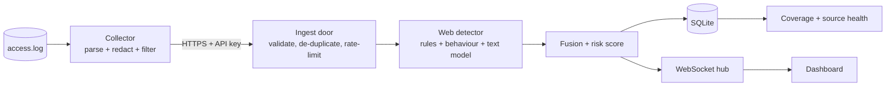

# Architecture

```mermaid
flowchart LR
  subgraph Sources
    SIM[Traffic simulator]:::s
    UP[CSV upload]:::s
    API[POST /detect/event]:::s
  end
  SIM & UP & API --> NORM[normalize_event<br/>clean + payload features]
  NORM --> SIG[Signature engine<br/>regex / threshold rules]
  NORM --> FE[Feature engineering<br/>34 features]
  FE --> ENS[Weighted ensemble<br/>RF + GB + MLP (+XGB/LGBM)]
  FE --> AE[Autoencoder<br/>anomaly score]
  SIG & ENS & AE --> FUSE[Fusion + severity scoring<br/>+ prediction cache]
  FUSE --> DB[(SQLite<br/>events / alerts / ...)]
  FUSE --> HUB[WebSocket hub]
  DB --> REST[REST API + RBAC]
  HUB --> UI[React dashboard]
  REST --> UI
  FUSE -. new alert .-> MAIL[Email notifier]
  classDef s fill:#1e293b,stroke:#3b82f6,color:#e2e8f0
```

## Live monitoring path (connectors)


Events from connectors carry `origin = connector` and a `source_id`; generated demo events carry `stream` or `seed`. Analytics accept a `scope` (live / demo / upload / all) so real and simulated data never mix. See [CONNECTORS.md](CONNECTORS.md).

## Layers (all under `backend/app/`)

| Package | Responsibility |
|---|---|
| `api/` | FastAPI routes (thin), dependencies (auth, RBAC), shared context |
| `schemas/` | Pydantic request models with bounds |
| `security/` | scrypt password hashing, HS256 JWT, RBAC, login throttle |
| `db/` | SQLite connection handling + `Repository` (the only place SQL lives) |
| `ml/` | feature schema, payload features, synthetic data, SMOTE, trainer, ensemble, autoencoder, explainability, model registry |
| `detectors/` | signature rule engine |
| `services/detection/` | hybrid pipeline (fusion, cache), severity scoring, `EventProcessor` |
| `services/ingestion/` | traffic simulator, CSV loader (CICIDS/NSL-KDD adapters, window features) |
| `services/connectors/` | web-event format + validation, behaviour tracker, ingest service, source health |
| `services/detection/web_pipeline.py`, `webfuse.py` | web detector pipeline and evidence fusion |
| `detectors/webrules.py`, `ml/webmodel.py`, `ml/webcorpus.py` | web signature rules, text model, corpus generator |
| `services/` | recommendation + mitigation, analytics (forecast), chatbot, reports (PDF/CSV), alerting, stream hub, model manager |
| `bootstrap.py` / `factory.py` | build the object graph (framework-free) / build the FastAPI app |

Every event source goes through **one** entry point (`EventProcessor`), so live traffic, uploads, API calls and simulator events are detected, scored, stored and alerted identically.

## Detection flow for one event

1. **Normalise** — validate IPs, bound numbers, derive text features from `payload_sample` (client-supplied payload features are overwritten, so they cannot be used to hide an attack).
2. **Signature rules** — high-precision regex/threshold rules (SQLi, XSS, brute force, scans, floods, ransomware, phishing URLs).
3. **ML ensemble** — CV-weighted soft vote; a threshold tuned on out-of-fold predictions caps the benign false-positive rate; picks the attack class.
4. **Autoencoder** — reconstruction error / calibrated threshold = anomaly ratio. If the event is anomalous *and* the classifier is unsure (best attack probability < `unknown_conf`), it is labelled **Zero-Day**.
5. **Fusion** — signature and ML agreeing → noisy-OR confidence (+ corroboration bonus); disagreement → the more confident wins, flagged.
6. **Risk score** (0–100) = base severity of the class × (0.55 + 0.45·confidence) + critical-asset bonus + repetition bonus + corroboration bonus → Low / Medium / High / Critical.
7. **Persist** — event row; threats also create or **bump** an alert (same source + attack type inside the dedupe window → one alert with a counter).
8. **Publish** to WebSocket clients; notify by email for new alerts at or above the configured severity.

Explanations (grouped feature occlusion) are computed for single events and the top-100 upload threats; any other alert is explained on demand when opened.

## Runtime

* One uvicorn worker. The WebSocket hub, login throttle, prediction cache and model hot-swap are per-process; scaling out needs Redis (pub/sub + throttle) and a shared DB (see roadmap).
* Detection is CPU-bound (~10–30 ms/event with the full ensemble); routes are sync `def` so FastAPI runs them in its thread pool, and the async simulator uses `asyncio.to_thread`.
* Retraining runs in a background thread; the new bundle is swapped in atomically and the cache cleared. The previous bundle keeps serving until then.
* The simulator only generates traffic while at least one dashboard is connected.
